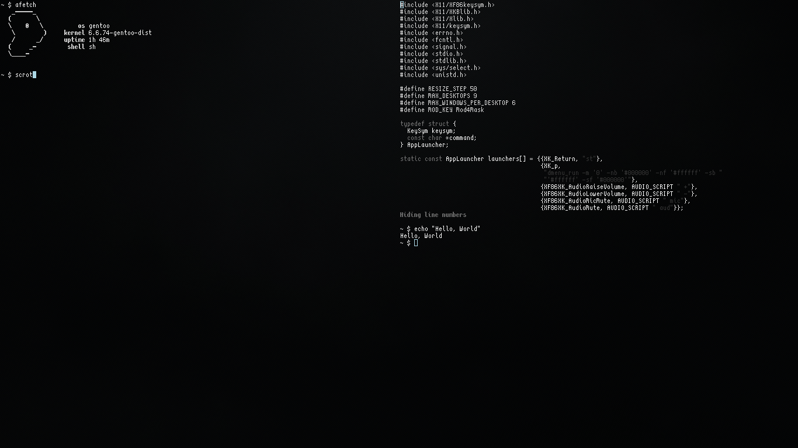

# Minimal Window Manager (MWM)

[](https://doi.org/10.5281/zenodo.15824542)


MWM is a lightweight X11 tiling window manager written in C. Its core is a
single source file and provides nine workspaces, keyboard-driven window
management, and no floating windows, status bar, borders, or gaps. For a
window manager with those features, see
[MWM+](https://github.com/KrzysztofMarciniak/minimal-window-manager-plus).



## Requirements

- A C compiler, `make`, and X11 development headers and libraries.
- Optional: `st` as the terminal and `dmenu` as the application launcher.

The default build checks for `st` and `dmenu`. If either is missing, it asks
before cloning, building, and installing the missing program from Suckless.
`st` requires `tic`, `pkg-config`, and Xft, fontconfig, and freetype development
files. `dmenu`'s default configuration requires Xinerama development files.
Install the corresponding packages for your OS before accepting the prompt.
Set `SUDO` to your privilege command and `PREFIX` to the install prefix if
needed.

## Build and install

```sh
git clone https://github.com/KrzysztofMarciniak/minimal-window-manager.git
cd minimal-window-manager
make
sudo make install
```

The Makefile supports GNU make and BSD make. Override compiler and install
settings as needed:

```sh
make CC=clang CFLAGS="-O2 -pipe" PREFIX=/usr/local
```

To stage MWM under a package root, use `DESTDIR`:

```sh
make DESTDIR=/package-root PREFIX=/usr install
```

Available targets:

| Target | Purpose |
| --- | --- |
| `make audio` | Create an executable `./audio` copy of `audio.sh` |
| `make clean` | Remove generated MWM and audio files |
| `make install_compressed` | Compress MWM with UPX, then install it |

The audio script is optional. By default, MWM uses `audio.sh` for media-key
bindings. To use the generated `audio` helper instead, build it and rebuild
MWM with its path:

```sh
make clean
make audio
make AUDIO_SCRIPT="$(pwd)/audio"
```

The audio script expects ALSA's `amixer` and, for notifications, `herbe`.
Change the `notifications_daemon` path in `audio.sh` to match your system.

## Start MWM

Add MWM to your X session startup, for example in `~/.xinitrc`:

```sh
exec mwm
```

If your session needs D-Bus, use your system's D-Bus session launcher.

## Keyboard shortcuts

### Window management

- **Mod + Enter**: Launch terminal
- **Mod + q**: Close focused window
- **Mod + Shift + q**: Exit MWM
- **Mod + j**: Focus left window
- **Mod + k**: Focus right window
- **Mod + Shift + l**: Increase window size
- **Mod + Shift + h**: Decrease window size

### Desktop navigation

- **Mod + [0-9]**: Switch to desktop [0-9]
- **Mod + Shift + [0-9]**: Move focused window to desktop [0-9]

### Application launcher

- **Mod + p**: Launch `dmenu`
